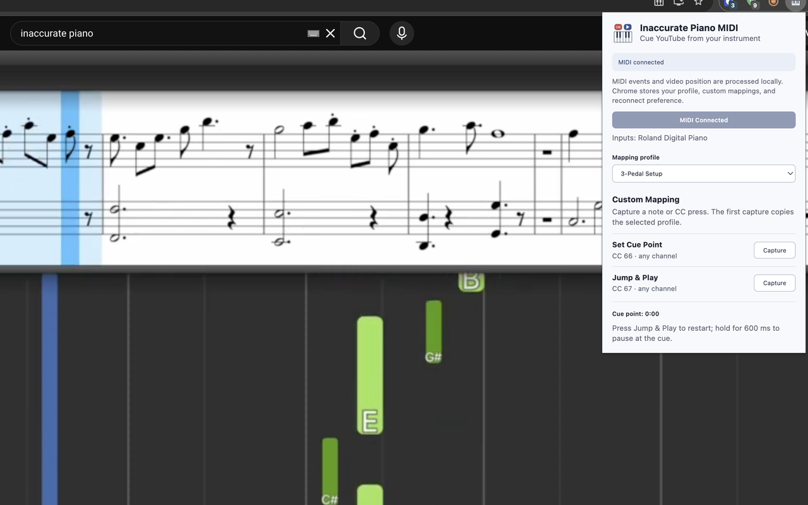

# Inaccurate Piano MIDI (Chrome Extension)

[Get it from the Chrome Web Store](https://chromewebstore.google.com/detail/inaccurate-piano-midi/gioffbcabdejddelghllbajeeneagflj)

Learning a piece from a YouTube video often means replaying the same few seconds over and over. Reaching for the mouse to pause, scrub back, and start again breaks your concentration and takes your hands away from the piano.

Inaccurate Piano MIDI lets a connected MIDI keyboard or pedals control the video instead. You can mark a starting point, restart playback from it, or hold the control to pause and return to that point, all from your instrument. It is a small Chrome extension with no account or external service.



[](https://www.youtube.com/watch?v=DU8FnSDe-7U)

## Cue and play while practicing

The idea comes from the **Cue/Play** controls on DJ decks. A cue point marks a place in a track that you want to return to quickly. This extension applies that idea to a YouTube video:

- **Set Cue Point** saves the video's current position.
- **Jump & Play** returns to that position and starts playback.
- **Hold Jump & Play** pauses the video and returns to the cue point.

For example, when a difficult phrase begins, set a cue point. Press Jump & Play to start from there. To hear the phrase again while the video is playing, press it again to restart from the cue. When you want to stop between attempts, hold it to return to the cue and pause there. Set a new cue when you move on. The repeat is triggered by you; the extension does not run an automatic loop.

Each new video starts with a cue at 0:00. Setting a cue replaces it for the current video.

## Setup

1. Connect a MIDI keyboard or pedals to your computer.
2. Install the extension, or [load it locally from source](#load-locally).
3. Open a YouTube video on a watch page, click the extension icon, and select a profile.
4. Click **Connect MIDI** and allow Chrome's MIDI access prompt if it appears.
5. Close the popup if you like; the controls keep working while the video page is open.

After access has been granted, the extension reconnects automatically on later watch-page loads. If you open a video from YouTube's homepage without a full page reload, open the popup once on the video page to attach the controls.

## Default controls

| Profile | Set Cue Point | Jump & Play (press) | Stop at Cue (hold) |
| --- | --- | --- | --- |
| **3-Pedal Setup** | Middle pedal (sostenuto), **CC 66** | Left pedal (soft/una corda), **CC 67** | Hold the left pedal, **CC 67** |
| **88-Key Piano** | Leftmost white key, **A0 / MIDI note 21** | First black key, **A#0 / note 22** | Hold the first black key, **A#0 / note 22** |
| **61-Key Piano** | Leftmost white key, **C2 / MIDI note 36** | First black key, **C#2 / note 37** | Hold the first black key, **C#2 / note 37** |

In every profile, pressing the Jump & Play control seeks to the cue and starts playback immediately; holding it pauses the video and returns to the cue. Other keys and pedals are left unmapped. All default mappings accept any MIDI channel.

The key positions above assume the usual A0 start for an 88-key piano and C2 start for a 61-key piano. Some instruments label octaves differently or send different MIDI numbers. The **MIDI note and CC numbers** in the table are what the extension actually listens for; use a custom mapping if your instrument differs.

## Custom mapping

To assign a control yourself, connect MIDI, click **Capture** beside an action, then press the key or pedal you want to use. The extension accepts a Note On or a Control Change (CC) press. It saves the message type, number, and MIDI channel locally, then switches to **Custom Mapping**.

Your first capture copies the selected profile, so the other action keeps its current assignment. You can then capture it separately. The same press and hold behavior applies to any note or CC mapped to Jump & Play. The popup rejects a control assigned to both actions; click **Cancel** to stop a capture in progress.

Your profile and custom mappings stay in Chrome's local extension storage. See the [privacy policy](PRIVACY.md) for details.

## Sponsorship

If you find this project useful, you can [sponsor its developer on GitHub](https://github.com/sponsors/lzap).

## Build from source

The extension uses plain JavaScript, HTML, and CSS. It has no npm dependencies. Python 3 and `make` are needed to create the Chrome Web Store ZIP:

```sh
make check
make package
```

The package is written to `dist/inaccurate-piano-midi-<version>.zip`, where `<version>` is read from `manifest.json`. The ZIP contains `manifest.json` at its root. The finished PNG icons are included in the repository. Increase the version in `manifest.json` before packaging a new release.

## Load locally

1. Open `chrome://extensions` in Chrome.
2. Enable **Developer mode**.
3. Click **Load unpacked** and select the project folder (the folder containing `manifest.json`).
4. Open a YouTube watch page and follow the [setup steps](#setup). After changing the source, click **Reload** on the extension card.

## Supported browsers

- **Supported:** Google Chrome
- **Untested:** Chromium, Microsoft Edge

## License

MIT. See [LICENSE](LICENSE).
